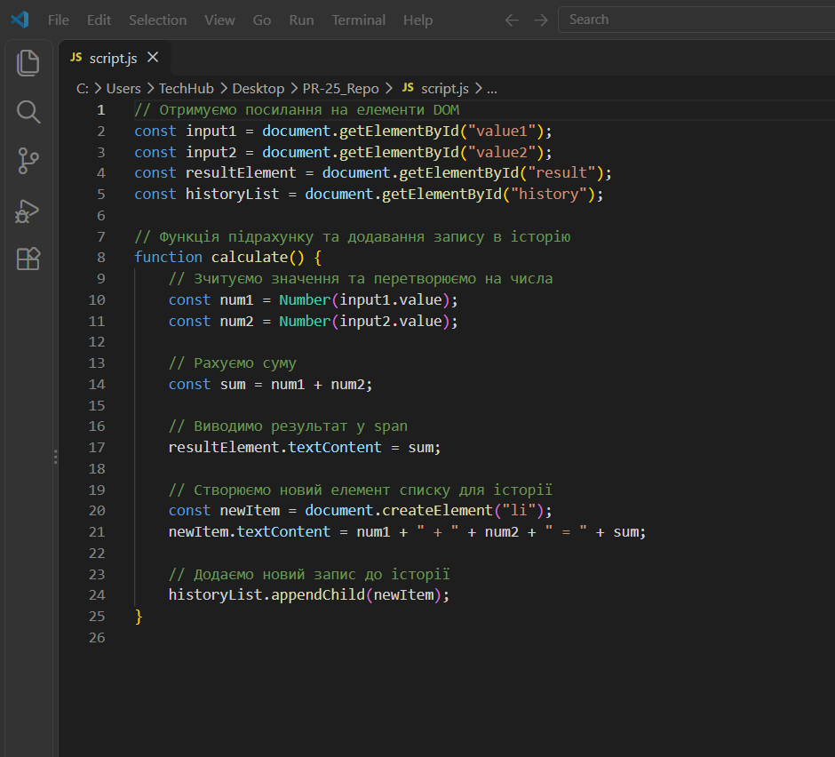
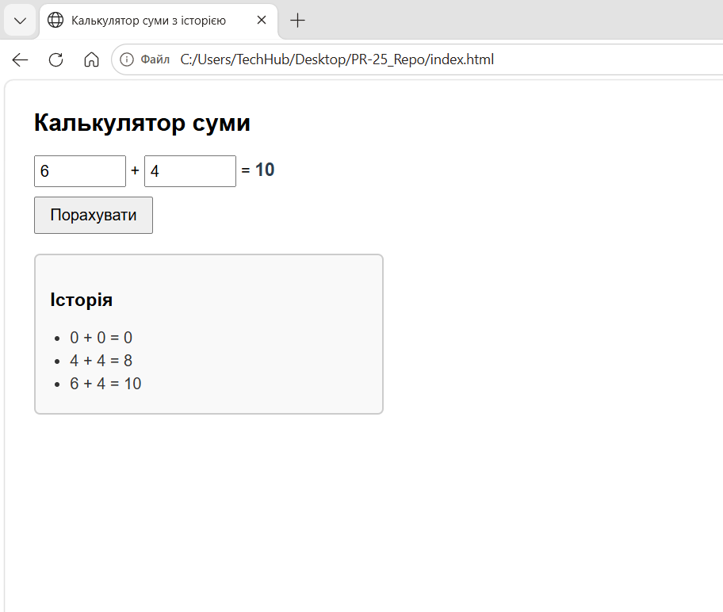
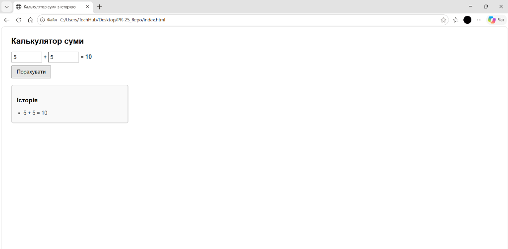
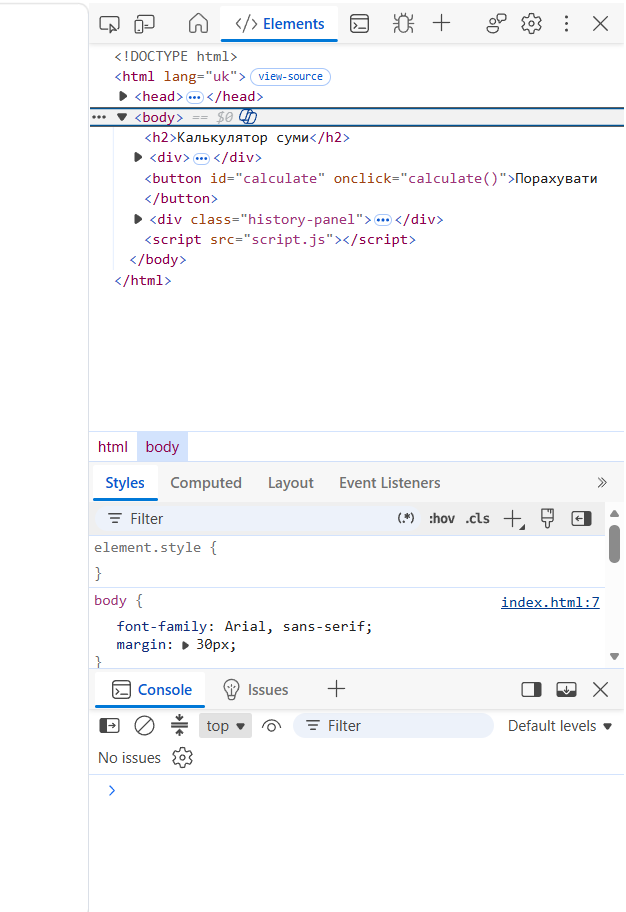

# ПР-25. Робота з DOM в JavaScript

**Дисципліна:** Веб-програмування  
**Студентка:** Овдійчук Марія  

---

## Тема роботи
Робота з DOM в JavaScript.

## Мета роботи
Опанувати практичні навички взаємодії з Document Object Model (DOM) засобами JavaScript; навчитися отримувати посилання на елементи веб-сторінки за їхніми ідентифікаторами за допомогою методу `document.getElementById()`; реалізувати зчитування даних користувача з текстових полів введення та їх явне перетворення до числових типів функцією `Number()`; налаштувати обробку подій кліку миші через подію `onclick`; навчитися змінювати текстовий вміст наявних DOM-вузлів через властивість `textContent` та динамічно створювати й додавати нові вузли за допомогою методів `document.createElement()` і `appendChild()`.

---

## Хід виконання роботи

### Крок 1. Розробка HTML-розмітки інтерфейсу калькулятора
У файлі `index.html` створено структуру веб-сторінки калькулятора суми:
- Текстові поля `<input type="text">` з ідентифікаторами `value1` та `value2` для введення доданків;
- Елемент `` для динамічного відображення підсумкового значення;
- Кнопка `<button id="calculate" onclick="calculate()">` для ініціації процесу обчислення;
- Блок історії обчислень `
` з маркованим списком `<ul id="history">`.

---

### Крок 2. Реалізація взаємодії з DOM у script.js
У файлі `script.js` реалізовано логіку взаємодії з елементами сторінки:
1. За допомогою `document.getElementById()` отримано посилання на поля введення, елемент результату та список історії;
2. Створено функцію `calculate()`, яка:
   - Зчитує текстові значення полів введення через властивість `.value`;
   - Явно перетворює їх на числовий тип за допомогою `Number()`;
   - Обчислює арифметичну суму чисел;
   - Записує отриманий результат у спан результату через властивість `.textContent`;
   - Створює новий елемент списку `document.createElement("li")` з текстом повної операції;
   - Додає створений елемент у кінець списку історії за допомогою `historyList.appendChild(newItem)`.

---

### Крок 3. Тестування роботи калькулятора у браузері
Файл `index.html` відкрито у браузері Chrome. Виконано серію обчислень із різними значеннями:
- Перевірено коректність додавання чисел (наприклад, `0 + 0 = 0`, `4 + 4 = 8`, `6 + 4 = 10`);
- Перевірено динамічне оновлення блоку результату;
- Підтверджено коректне накопичення кожного нового рядка в блоці «Історія» без перезавантаження веб-сторінки.

---

### Крок 4. Дослідження структури DOM-дерева в DevTools (F12)
За допомогою інструментів розробника браузера (вкладка `Elements`) досліджено внутрішню структуру сформованого DOM-дерева:
- Перевірено наявність та коректність атрибутів елементів (`id`, `onclick`);
- Перевірено відсутність помилок виконання скрипту у вкладці `Console`.

---

## Відповіді на контрольні запитання

### 1. Який метод використовується для отримання елемента сторінки за значенням його id, і що саме він повертає? Чому для такого вибору достатньо саме цього методу, а не потрібен пошук за CSS-селектором?
**Відповідь:**  
Використовується метод `document.getElementById()`, який повертає посилання на один конкретний DOM-елемент із заданим ідентифікатором (або `null`, якщо елемент не знайдено). Оскільки `id` на сторінці завжди унікальний, цей метод оптимізований браузером і працює швидше та однозначніше, ніж універсальні методи пошуку за CSS-селекторами (`querySelector`).

### 2. Чому значення властивості value текстового поля потрібно явно перетворювати функцією Number() перед арифметичною операцією?
**Відповідь:**  
Властивість `value` поля введення завжди повертає значення у вигляді текстового рядка (тип `string`). Якщо не виконати перетворення до числа через `Number()`, бінарний оператор `+` замість додавання виконає конкатенацію (склеювання рядків).

### 3. Що станеться зі значенням "2" + "3", якщо не виконати перетворення типів, і чому?
**Відповідь:**  
Результатом буде текстовий рядок `"23"`, оскільки оператор `+`, застосований до двох рядкових операндів, виконує конкатенацію (з'єднання рядків).

### 4. Яким чином атрибут onclick пов'язує кнопку в HTML-розмітці з функцією, оголошеною у файлі script.js?
**Відповідь:**  
Атрибут `onclick` містить вираз виклику функції JavaScript (наприклад, `onclick="calculate()"`). Під час кліку користувача на кнопку браузер генерує подію `click` і автоматично викликає відповідну функцію з глобальної області видимості скрипту.

### 5. Чим підхід через атрибут onclick відрізняється від підписки на подію методом addEventListener()?
**Відповідь:**  
- `onclick` вказується безпосередньо в HTML-розмітці і дозволяє призначити лише одну функцію-обробник (повторне призначення перезаписує попереднє);  
- `addEventListener()` викликається виключно з JavaScript-коду, розділяє розмітку і логіку та дозволяє підключати декілька незалежних обробників до однієї й тієї самої події.

### 6. Чим відрізняється зміна вмісту наявного елемента через textContent від додавання нового елемента через createElement() і appendChild()?
**Відповідь:**  
- `textContent` повністю перезаписує текстовий вміст всередині вже існуючого в документі елемента;  
- `createElement()` створює абсолютно новий DOM-вузол у пам'яті, а `appendChild()` вставляє його в DOM-дерево як останній дочірній елемент контейнера, зберігаючи всі попередні вузли.

### 7. Чому для показу результату обчислення достатньо змінити вміст одного елемента, а для історії потрібно щоразу створювати новий?
**Відповідь:**  
Результат повинен відображати лише останнє поточне значення обчислення (тому ми оновлюємо той самий тег ``), а історія має накопичувати кожен окремий запис послідовно (тому для кожної нової операції створюється свій новий елемент `<li>`).

### 8. Що станеться зі списком історії, якщо замість appendChild() щоразу змінювати textContent контейнера історії?
**Відповідь:**  
Попередні записи будуть щоразу стиратися і перезаписуватися останнім рядком, через що в блоці історії завжди залишатиметься лише один останній результат замість накопичувального списку.

---

## Висновок
Під час виконання практичної роботи № 25 було закріплено практичні навички маніпуляції DOM-деревом у JavaScript. Створено інтерактивний калькулятор із накопичувальною історією обчислень. За допомогою методу `document.getElementById()` реалізовано доступ до вузлів документа, зчитування та явне приведення типів за допомогою `Number()`. За допомогою атрибута `onclick` налаштовано виклик обробника події, реалізовано динамічну зміну вмісту через властивість `textContent` та створення нових елементів списку методами `document.createElement()` і `appendChild()`.
